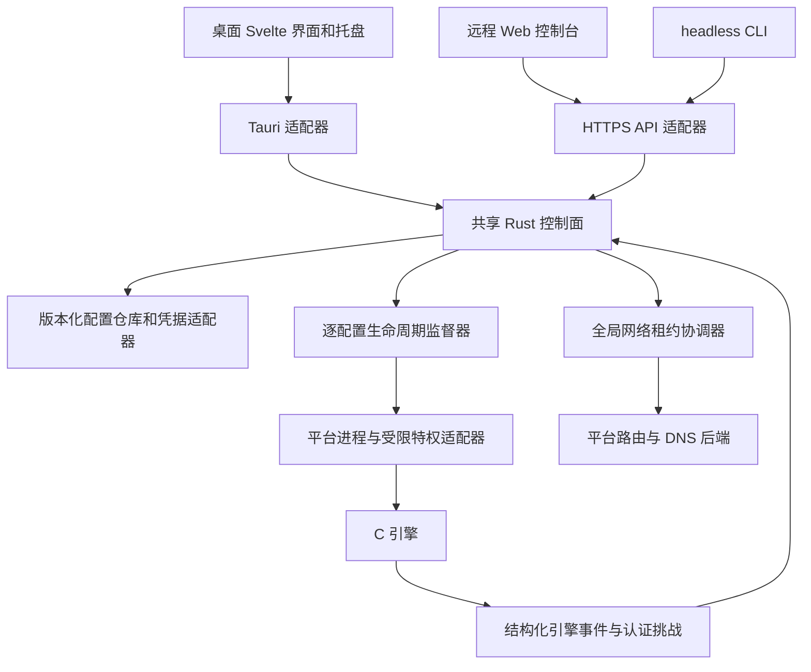
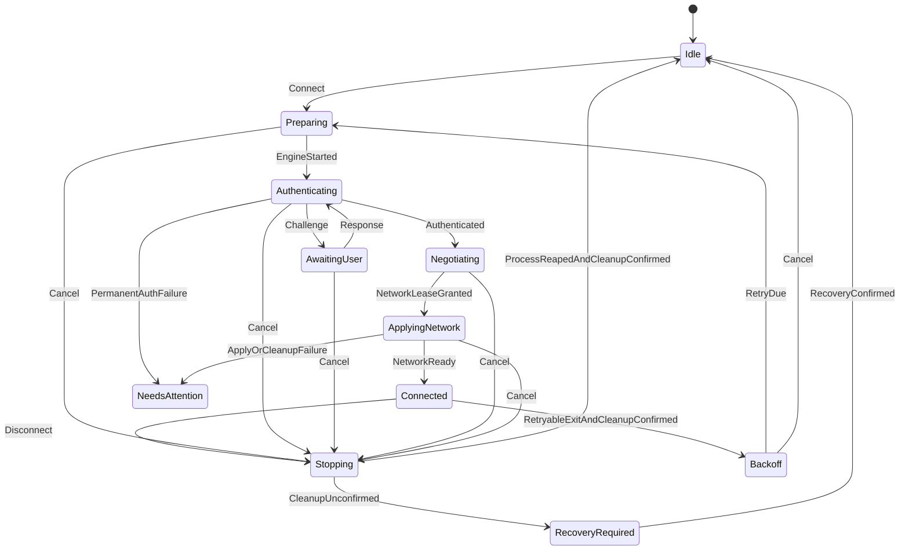

# 技术方案与完整开发计划

日期：2026-10-09。依据 [技术评估](technical-review.zh-CN.md)，基线 `126ba3a`。本文保留用户已授权执行的原始技术方案；下文“拟议”描述当时的目标设计。当前实现、未完成的软件和验收证据以 [任务账本](../.codex-tasks/reliability-control-plane/TODO.csv) 与 [开发进度](../.codex-tasks/reliability-control-plane/PROGRESS.md) 为准。工作量为工程估算，需要在首个里程碑后按实际吞吐调整。

## 1. 交付目标与顺序

先让现有功能满足可验证的安全性、数据正确性和可恢复性，再扩展认证与网络能力。保留 C 隧道引擎、Rust 控制面、Tauri 2/Svelte 5 桌面及 Axum HTTPS 技术栈。

三个建议发布边界：

| 里程碑 | 交付目标 | 允许声明的支持范围 |
| --- | --- | --- |
| R1 稳定性候选版 | TLS/生命周期/存储/API 核心修复，保守网络冲突阻断，关键回归 | 单网络修改连接；多 profile 管理；已验证的认证方式 |
| R2 统一控制面版 | 公共 Rust 核心、存储恢复、事件契约、诊断和发布证据 | 桌面/headless 同等业务语义；崩溃恢复与升级受控 |
| R3 能力完善版 | 经验证的多隧道网络仲裁、split DNS、OTP/SAML 和前端完善 | 仅声明实际通过平台矩阵的并发/认证能力 |

版本号在进入候选发布时决定；R1/R2/R3 不是已承诺的版本号。完整 IPv6 隧道、多租户权限、HA、策略路由 namespace 隔离、自动更新和全面替换 C 引擎不在首轮计划中。Windows 非管理员 UI 的服务化迁移作为独立扩展，见第 10 节。

## 2. 架构决策

| 方案 | 优势 | 成本/限制 | 结论 |
| --- | --- | --- | --- |
| 继续独立维护桌面与 headless | 初期代码改动最少 | 已发生校验、状态、API 分叉；回归重复 | 仅用于紧急修复过渡 |
| 共用 Rust 业务核心，各端保留 adapter | 直接覆盖已有分叉；不改变部署形态 | 需要定义边界与双入口迁移测试 | 推荐 |
| 所有平台改成统一系统 daemon | 能统一权限/长期运行 | 大幅改变安装、IPC、账号与升级模型 | 作为后续权限分离项目 |
| 全量重写引擎或应用 | 可以重建协议/模块 | 兼容性与平台验证成本高，不能快速关闭现有问题 | 当前不采用 |

目标数据流：



CLI 安装/卸载仍为管理员本地操作；在线配置变更经控制面，不直接修改运行中服务的文件。离线迁移和恢复工具必须获取目录锁。图中的网络后端是 R3 目标；R1/R2 仍由引擎修改网络，同时使用保守租约阻断。

拟议目录：

```text
Cargo.toml                         # 公共 workspace 与统一质量命令
crates/manager-core/src/
  domain.rs                        # profile、操作、状态、typed error
  validation.rs                    # C 输入约束与认证校验
  lifecycle/                       # actor、取消、重试、监督任务
  repository/                      # revision、迁移、commit journal
  protocol/                        # 引擎 capability、事件、挑战
  network/                         # 租约、冲突模型、恢复结果
crates/manager-http/src/            # router、授权、DTO、错误与契约测试
app/src-tauri/src/                  # Tauri、tray、平台凭据/权限 adapter
app/src/lib/components/             # profile、连接、日志与对话框
app/src/lib/services/               # IPC/HTTP、snapshot/event store
web/                               # 独立构建的远程客户端
headless/src/                      # CLI、systemd、Linux adapter
app/src-tauri/helper/               # 小型特权程序，保持白名单
src/                               # 现有 C 引擎及新协议边界
tests/integration/                 # 假引擎、跨入口和网络恢复测试
scripts/verify-local.zsh            # 分层验证入口
docs/DEVELOPMENT.md                 # 平台 setup、验证、贡献流程
```

helper 不引入 Tauri/HTTP/WebView 依赖；workspace default members 和 feature 防止 headless 构建拉入桌面库。为了固定 helper payload 的升级行为，workspace lockfile 迁移需单独审阅，不能仅因管理器版本升级就修改 helper version。

## 3. 统一生命周期

### 3.1 状态与不可变规则

用户意图 `desiredConnected`、进程实际生存 `processAlive`、隧道阶段 `phase`、网络配置结果 `networkReady` 分开建模。现有 v1 的六个状态保留映射；内部使用更明确的枚举。



图为主要路径；其他阶段的失败也必须经过监督器确认退出/清理，才进入 Backoff、NeedsAttention 或 RecoveryRequired。NeedsAttention 不意味着可以丢弃仍存活的进程。

必须满足：

1. 每个 profile 最多一个拥有生命周期的 attempt，包括 Preparing、Stopping 和恢复中。
2. 断开立即取消用户连接意图和待执行重试，但保留进程/网络所有权直到收割与清理确认。
3. 更新/删除配置与 connect/disconnect 在同一 profile actor 排队；不只依赖 UI 按钮。
4. 事件携带 `profileGeneration + attemptId + eventSeq`，旧 attempt 不能改变新 control、实例或租约。
5. 只有 supervisor 的退出与清理结果可宣告终态；错误诊断事件不能单独宣告进程死亡。
6. 已连接必须代表认证、PPP、必要路由/DNS均完成。网络失败时不得继续显示完整 Connected。
7. 手动重连先完成 stop，再新建 attempt；同一请求重试有 idempotency key。

### 3.2 实现方式

R1 先在现有 headless 上加逐 profile 操作锁/状态预约、进程退出确认和旧 generation 防护，减少修复范围。随后公共核心采用一个 supervisor + 每 profile 一个异步 actor；actor command 只排队业务意图，耗时进程/凭据操作通过可取消 worker 完成，结果回到 actor。不得跨等待持有全局 Mutex。

重连使用带随机扰动的有上限指数退避，认证/证书/配置错误进入 NeedsAttention，瞬时网络错误允许重试。原有“最多 30 秒间隔持续重试”可作为默认兼容策略，增加网络不可用暂停、稳定运行后重置 attempt 和可配置重试预算。sleep/wake、网络切换先触发重新评估，不直接启动第二个进程。

启动次序为：读取/迁移配置 → 目录/实例锁 → 恢复运行记录 → 校验引擎 capability/权限 → 建立 API/tray → 启用 auto-connect。关闭次序为：禁止新操作 → 取消 auto-connect/retry → 限时收敛已有操作 → 停止并收割进程 → 确认网络清理 → 提交 journal → 停 API/退出。

## 4. 协议与 API

### 4.1 引擎边界

拟增加 `--capabilities-json`，输出引擎版本、事件协议版本、认证与网络能力。管理器使用随包固定引擎；旧系统引擎必须明确列为 legacy capability，不能仅通过 --version 可执行就声称完全兼容。

事件拟采用 NDJSON：

```json
{
  "protocolVersion": 2,
  "attemptId": "opaque-attempt-id",
  "seq": 17,
  "event": "error",
  "phase": "authenticating",
  "reasonCode": "AUTH_REJECTED",
  "retryable": false,
  "message": "Gateway rejected authentication"
}
```

C CLI 默认交互行为继续存在；管理器模式使用专用控制管道，不与 PPP 数据、sudo 安装密码或普通日志复用。Unix 可采用继承 FD/受限 socket，Windows 可采用 pipe。helper 只代理固定版本的 typed 消息，限制长度、超时、nonce 和所有者；不能转发任意路径、命令或 pppd 扩展配置。

协议至少覆盖 `capabilities/state/error/cert_error/auth_challenge/network_plan/network_applied/tunnel_ready/cleanup_result`。事件序列的身份由 manager 启动参数或 supervisor 封装绑定；保留 v1 映射用于渐进迁移。错误分类不能靠中文/英文文本推断。输出流需要 EOF/join，单行过长按协议错误处理。

### 4.2 HTTP/IPC 契约

共享 DTO 与 use-case service，Tauri command 与 HTTPS handler 仅负责授权、转换和调用。统一错误形状：

```json
{
  "error": {
    "code": "PROFILE_BUSY",
    "message": "连接正在停止，请稍后重试",
    "retryable": true,
    "requestId": "request-id"
  }
}
```

建议映射：输入错误 400；未授权 401；不存在 404；版本/状态/网络冲突 409；内部失败 500；操作已排队 202 + operationId。v1 先兼容现有 `error/message`，破坏性新响应进入 v2；不要直接修改 v1 字段而让现有页面失效。

新增 `/capabilities`、revision snapshot、operation 状态及增量 events/logs cursor。connect 在相同 generation 上重复调用返回已有 operation/instance；更新 profile 使用 expectedRevision，错误时不覆盖新版本。删除使用显式参数或独立操作表达“停止后删除”，页面显示相同语义。

远程仍默认 HTTPS+loopback+高熵 Bearer token，无开放 CORS。权限/安装密码/未知证书确认只在规定的本地可信入口进行。令牌热轮换经本地受限控制入口更新内存 token，旧 token 立即失效且不停止 VPN。单管理员部署先保留该模型；多用户需求出现后再扩展权限范围。

登录不得复用会吞错的后台 refresh；401 清凭据并留在登录界面，网络失败显示离线与重试，旧请求不能恢复已退出会话。轮询阶段用单次请求调度 + AbortController，随后可切换 fetch SSE。永久 token 不放 query string。

## 5. 配置、凭据与恢复

### 5.1 数据与事务

定义 schemaVersion、profileRevision、credentialRef、explicit credential action。共用严格校验：C 定长字段按 UTF-8 字节；禁止 NUL/换行；证书 pin 规范化；密码不偷偷 trim；不支持的 auth/route/DNS 功能明确报错。

R1 的存储锁覆盖全部读改写及 profiles/secrets 配对更新。R2 建立 Repository 接口；headless 推荐 SQLite 事务存非秘密元数据与 secret reference，凭据后端可用 root 私有存储。桌面平台密钥库不受 SQLite 事务控制，采用：

1. 写不含秘密的 intent journal 与 operation ID，记录旧/new credential reference。
2. 将新 credential 写入新 reference，不覆盖旧 credential。
3. 事务提交 profile、reference、revision 与完成标记。
4. 回收旧 reference，回收失败留 orphan 标记并重试。
5. 重启时依提交状态清理未提交的新 reference，或完成已提交的回收。

文件后端使用私有临时文件、sync、平台支持的原子替换及父目录持久化；Windows 使用可验证的原子替换 API。读取验证 regular file/owner/mode，不先读取秘密再做 symlink 检查。锁必须覆盖跨 CLI/service 访问。

是否统一桌面也采用 SQLite，应在 M3 spike 根据包体、迁移和测试成本决定；首轮不要求迁移现有 profiles.json。Repository 抽象保证两种实现遵守相同事务契约。

### 5.2 迁移与回滚

迁移前生成私有备份、验证旧文件、检测重复 ID 和未知 schema，先完整解析再写。不同凭据政策间迁移必须展示位置、保护方式与失败处理；新 credential 验证成功后才能删除旧 credential。

运行记录需要绑定 profile/attempt、进程启动身份、固定可执行文件身份、helper 协议、已应用网络资源及 cleanup outcome。重启不能只凭 PID 杀进程，也不能只凭旧文本路由快照覆盖当前网络。确认资源仍属于该实例才回收，未知状态阻止 auto-connect 并提示恢复。

不可逆 schema 切换后，旧二进制不得直接覆盖新数据。回滚分两步：安装上一版本完整 bundle，并恢复/导出它可识别的 profile schema。helper 与 engine 使用成对版本/协议兼容检查，升级采用 staging → 校验 → 切换 → 恢复点；不把管理器升级直接等同于任意覆盖 helper。

## 6. 路由与 DNS 方案

### 6.1 R1 的可行保护

由于当前引擎在配置阶段即可修改系统资源，R1 对 `setRoutes`、`setDns`、`pppdUsePeerdns` 及其他隐式平台网络修改采用保守租约。首个网络修改连接获得 owner，后续冲突连接在启动前返回 NetworkConflict，不依赖文档提醒。租约也覆盖 starting/stopping/recovery，不能在发 SIGTERM 时立即释放。

只有实证不存在共享网络副作用的模式才可并发；不能只因为两配置都选了 no-routes/no-dns 就默认安全，例如 Unix 仍有 pppd 路由处理。UI 明确告知当前安全支持边界与冲突 profile。此改动收紧旧的并发承诺，需发布说明及迁移提示。

### 6.2 R3 的完整仲裁

引擎认证/获取配置后，**在创建或修改网络资源前**报告计划，并等待 manager 的 lease decision。仅事后读取 route event 不足以解决竞争。计划包含网关可达路径、IPv4 CIDR、interface/metric、default/half route、DNS servers/search domains 和平台 capability。

冲突规则首版：

| 资源 | 默认策略 | 清理策略 |
| --- | --- | --- |
| default route 或两个 /1 route | 同时一个 owner | 仅回收本 owner 创建的资源 |
| 相同或重叠目的 CIDR | 拒绝；显式策略功能另立项 | 记录 destination/interface/metric 的精确身份 |
| gateway exception route | 相同下一跳可共享，引用计数 | 最后租约释放时删除，保留原有路由 |
| 全局 DNS | 同时一个 owner | 恢复自有改动；不覆盖别的程序更新 |
| split DNS 域 | 非重叠域可独立 owner | 按域和 interface 回收 |
| 外部网络变化 | 重新评估/暂停/重新申请 | 不盲目恢复旧默认路由快照 |

网络应用是 prepare/apply/commit/rollback 事务。记录哪些资源是预先存在、哪些是本次创建，失败回滚已成功的步骤；cleanup 未确认即保留 journal 与租约。支持先读计划和 dry-run 预览。

平台后端分开验收：Linux 优先 netlink + systemd-resolved D-Bus；resolvconf/直接文件为显式 fallback；macOS 使用受限 SystemConfiguration/平台接口的 scoped DNS 方案；Windows 使用 IP Helper/接口 DNS API，逐步收敛 netsh 并检查所有结果。每个平台先做 capability spike，不凭 API 名称承诺 split DNS 立即可用。

保留传统 C CLI 的独立网络模式。管理器与支持新协议的 bundled engine 使用协调模式；旧引擎降级到 R1 保守独占，不获得完整多隧道能力。

## 7. 前端与认证体验

Svelte 页面拆为 profile editor、connection panel、log viewer、certificate prompt、privilege setup、remote settings 和应用偏好。只共享数据与业务逻辑，桌面托盘/权限安装 UI 保留平台差异。远程页面从单行 inline script 转为有构建和类型检查的独立入口，再收紧 script CSP。

UI 使用 capability 呈现真实支持范围：headless 不显示无效 useSudo；会话密码不支持时明确禁用；不允许 autoConnect 配合缺失凭据；停止中显示等待退出；错误显示 reasonCode 对应的可执行操作。对话框焦点、Escape、键盘操作、读屏状态和离线提示纳入测试。

OTP：challengeId、attemptId、prompt、expiresAt、remainingAttempts；响应只通过内存管道，提交后清理，绝不保存为 profile password。对取消、过期、重连新 challenge、多个 profile 并发均有明确行为。

SAML：使用系统低权限浏览器；绑定当前 attempt 的 state/nonce，回调一次性有效；校验 loopback peer、HTTP method、精确路径、长度和 token 格式。先验证测试 FortiGate 的实际 redirect/cookie 行为；不能假设改用 OIDC 就兼容所有现有 SAML 网关。headless 默认不承诺无人值守的交互 SAML；必要时使用可信客户端认证 broker 或厂商支持的非交互方法。

客户端证书：管理器保存受控 credential reference；helper 验证安装位置/权限，拒绝任意 user-key/pppd 插件路径。该能力在 R3 作为后续扩展验证，不是 R1 的修复阻断项。

## 8. 工作分解与验收

下面的人日包含实现、单元/组合测试、review 修复及相关文档；不包含独立 QA 的全平台人日。角色是建议分工，不代表已经创建 agent 或分派人员。A 为 Rust/生命周期，B 为 C/网络，C 为前端/QA；人员不足时按依赖串行执行。

| 任务 | 对应发现 | 工作内容与完成标准 | 建议责任 | 依赖 | 人日 |
| --- | --- | --- | --- | --- | --- |
| T01 | F14/F16 | 建 verify-local、DEVELOPMENT、基线和受控测试矩阵；失败返回非零 | A/C | 无 | 3–4 |
| T02 | F02/F03/F04/F08 | 将隔离复现转成确定性回归；修复前应失败，修复后通过 | A/C | T01 | 3–4 |
| T03 | F01 | 统一 TLS policy、DNS/IP SAN、pin、insecure 语义；Windows 套件通过 | B | T01 | 4–6 |
| T04 | F02/F06/F07 | 停止预约、wait/reap、取消/旧 generation 防护；仅实际 tunnel_up 就绪，输出 EOF 收敛 | A/B | T02 | 4–6 |
| T05 | F03/F10 | 完整存储锁、跨进程写入边界、配对恢复标记；并发不丢写 | A | T02 | 4–6 |
| T06 | F04/F09 | 统一校验/凭据 action、pin 规范化、IPv6 bind、TLS 配对/SAN | A | T02 | 3–5 |
| T07 | F08 | Web 严格登录/离线、错误字段兼容、删除语义与 HTTP 状态 | C/A | T02 | 3–4 |
| T08 | F05/F06 | 保守网络租约、所有入口冲突检查、停止后释放；网络 apply 失败不宣告完整 Connected | A/B | T04 | 3–5 |
| T09 | F13 | workspace + 公共 domain/validation/protocol DTO；不拉入 Tauri | A | T03–T07 | 4–6 |
| T10 | F02/F06/F13 | 公共 profile actor、supervisor、timer 与 fake-clock 测试 | A | T09 | 7–10 |
| T11 | F06/F14 | C capabilities/event v2、typed errors、ready/cleanup 与输出完成 | B | T09 | 5–8 |
| T12 | F08/F13 | 共用 HTTP/use-case、v1 adapter、v2 contract、operation/revision | A | T10/T11 | 4–6 |
| T13 | F10 | Repository 事务、凭据 reference journal、故障注入与迁移备份 | A | T09/T05 | 6–9 |
| T14 | F07/F10 | headless/app startup shutdown guard、目录锁、crash recovery | A/B | T10/T11/T13 | 6–9 |
| T15 | F12/F16 | 签名渠道凭据策略、私有文件一致性、helper 升级协议与文档 | A | T13/T14 | 3–5 |
| T16 | F05 | network plan/lease 协议、事务模型、重叠检查、引用计数 | A/B | T08/T11/T14 | 7–10 |
| T17 | F05/F06 | Linux route/DNS 后端与 namespace/VM 清理测试 | B | T16 | 6–9 |
| T18 | F05/F06 | macOS scoped route/DNS spike、实现及恢复测试 | B | T16 | 7–10 |
| T19 | F05/F06 | Windows route/DNS API、返回值/回滚与 VM 测试 | B | T16 | 7–10 |
| T20 | F11 | OTP typed challenge、管道、取消/过期/并发测试 | A/B/C | T10/T11 | 6–9 |
| T21 | F11 | SAML 浏览器/回调关联、实际网关兼容与取消测试 | A/B/C | T20 | 7–11 |
| T22 | F08/F13/F15 | Svelte 模块与独立 Web build、capability UI、前端行为测试 | C | T09/T12 | 6–9 |
| T23 | F15 | 日志 ID/字节预算/实例 TTL、metadata 缓存、cursor/诊断包 | A/C | T10/T12 | 4–6 |
| T24 | F14/F16 | 组合 CI、依赖/SBOM、签名 manifest、安装升级回滚验收 | A/B/C | 各阶段增量；最终 T14/T17–T23 | 7–10 |

基础全量 T01–T24 合计 **119–177 工程人日**。客户端证书、完整 Windows/Linux 权限分离和完整 IPv6 数据面另计，不能藏在该估算内。网络后端与真实 SAML 是主要不确定性；如果 spike 不满足支持目标，缩小 capability 或另立后续任务，不跳过验证。

## 9. 执行阶段、排期与发布门槛

### 9.1 阶段依赖

| 阶段 | 任务 | 输出 | 出口门槛 |
| --- | --- | --- | --- |
| M0 基线与回归 | T01/T02 | 验证入口、失败用例、兼容矩阵 | 原问题可稳定检测；测试不修改宿主网络 |
| M1 核心修复 | T03–T08，T24 基础门槛 | R1 候选包 | P0 清零；无进程重叠/丢写/假登录；网络冲突阻断；未就绪或 apply 失败不显示完整 Connected |
| M2 公共控制面 | T09–T12 | 统一业务核心与事件/API 契约 | 桌面与 headless 同套契约通过；旧 v1 客户端可用 |
| M3 存储与恢复 | T13–T15，T23 核心容量 | R2 候选包 | 中断/崩溃/升级/回滚与重复恢复通过；无未解决 cleanup 状态被隐藏 |
| M4 网络仲裁 | T16–T19 | 逐平台多隧道 capability | A/B 任意停止次序及外部网络变化无越权清理；不支持的后端明确降级 |
| M5 认证与客户端 | T20–T23 | OTP/SAML、共享客户端状态与诊断 | 实际网关挑战、取消、到期、重连；键盘/离线/API行为通过 |
| M6 完整发布 | T24 最终门槛 | R3 包、manifest、迁移及运维材料 | 每个平台签名与功能证据齐全；无未关闭 P0/P1 |

M4/M5 的独立实现可在 M2/M3 接口冻结后交错，但不能提前接受未定义的网络/认证通道。R1 不等待大规模重构；共用 crate 迁移后重新验证同一行为，不能因为旧实现已有测试就略过新实现。

### 9.2 资源假设与可行工期

按 **2 名工程师 + 0.5 名 QA**，每周 10 个工程人日、80% 有效计划容量估算，基础全量约 **15–23 个工作周**；加入 15–20% 平台/网关缓冲，规划窗口为 **18–28 周**。这是工作量折算，不是从今天起承诺的发布日期。

R1 的 T01–T08 为 **27–40 人日**，另分摊 T24 与候选 QA，建议 **4–6 周**交付候选。R2 在累计约 **9–13 周**进入候选；R3 按全量窗口安排。三名工程师且 C/网络/前端有独立负责人时可压缩实现时间，但真实网关/平台验收仍是关键路径。单人应缩小每版范围，先交付 R1，不能通过省略恢复测试压缩进度。

建议每周验收一个可安装、可演示的增量；M0 结束后更新估算，M1 结束后重新决定 M4/M5 次序。无真实 FortiGate 测试环境时，SAML 兼容与正式多网络支持不得标记完成。

### 9.3 变更和 review 流程

每个任务先写不可变规则/失败用例，再实现最小改动，再验证、review 和文档。P0/P1 按行为拆 PR，公共 crate 按边界迁移；禁止把目录搬迁、权限协议和网络算法揉成一个 PR。重大实现从 `codex/` 工作分支开展，不在 master 直接开发；提交说明同时中文与英文。

每个 PR 必须提供：触发条件、行为前后、影响平台、测试证据、schema/protocol 影响和回滚方式。共享接口变化需要业务与平台责任人 review。涉及实际 root 网络写入的验收在一次性 VM/namespace 中完成，宿主开发机只运行纯逻辑或假引擎测试。

## 10. 独立扩展任务

| 扩展 | 前置条件 | 估算 | 接受条件 |
| --- | --- | --- | --- |
| Windows 非管理员 UI + service | T10/T11/T14，明确威胁模型 | 12–18 人日 | named pipe ACL、用户/实例归属、installer upgrade、异常 cleanup 全部通过 |
| Linux 非 root HTTPS 控制面 + helper | T10/T11/T14 | 8–12 人日 | 固定引擎、有限网络/认证 API、对任意路径/命令拒绝，systemd 权限审查 |
| 客户端证书/硬件凭据 | T13/T15/T20 | 6–10 人日 | credential reference、PIN交互、路径白名单，平台/网关兼容 |
| IPv6 数据面与多地址网关连接 | T11/T16，明确路由策略 | 需 spike 后估算 | TLS IP SAN、AF_INET6、IPv6 路由/DNS/PPP 全链路测试 |
| 多用户权限/OIDC/审计保留 | 已确认多管理员/组织需求 | 需需求后估算 | viewer/operator/admin 操作隔离、撤销与审计；不改变现有单用户契约 |

首轮可通过文档和 capability 限制控制范围；不以引入多用户身份系统作为所有可靠性修复的前置条件。

## 11. 测试矩阵与量化验收

| 层级 | 场景 | 运行位置 | 阻断条件 |
| --- | --- | --- | --- |
| L1 纯逻辑 | 状态迁移、generation、字段字节长度、pin、错误映射、租约冲突 | 每 PR，Rust/C/TS | 任意失败 |
| L2 假进程/存储 | 并发连接、延迟 TERM、stop失败、旧事件、write故障、错误登录 | 每 PR，临时目录/假引擎 | 数据丢失、重叠、误重试、错误成功 |
| L3 平台集成 | helper真实提权、PID reuse、route/DNS apply/rollback、关闭/重启 | Linux namespace/VM、macOS/Windows VM | 不属于本实例的资源被改变或无法恢复 |
| L4 网关兼容 | 密码/Realm/OTP/SAML、证书变化、代理/网络切换、多隧道 | 受控 FortiGate 与测试账号 | 宣称支持的路径失败 |
| L5 分发 | 干净安装、升级、签名、公证、DLL、卸载保留数据、回滚 | 候选包和正式发布 | 缺附件、签名不符、升级失效、敏感输出 |

重点验收目标：

1. 并发命令交错测试至少 1000 轮；同 profile 同时 live attempt 最大值为 1，手动断开后的重试次数为 0。
2. 并发保存 100 个不同 profile，所有成功请求均可读取；同 profile 冲突通过 revision 拒绝或顺序提交，不静默覆盖。
3. 在写临时文件、凭据写入、profile commit、旧凭据回收等边界注入失败；重启后只能是旧一致状态、新一致状态或明确 RecoveryRequired。
4. 多隧道 A/B、A先停/B先停、断网、DHCP/接口变化、app SIGKILL、engine SIGKILL、systemd restart；重复恢复幂等、不删除外部资源。
5. wrong-host、IP SAN、unknown/expired CA、pin changed、TOFU拒绝；所有平台一致，自动连接不会自动接受证书。
6. 401/400/409/500、慢请求、重复提交、token轮换、页面退出/重新登录；只有认证成功可进入管理界面，后端始终独立授权。
7. 24小时重连/log stress：有明确容量上限，无持续无界增长；建议起始预算单行64KiB、总日志8MiB、保留已结束实例100条或7天，最终按基准确认。
8. 关闭 deadline 建议30秒全局预算，在测试过的最大连接数内执行；超时显示/记录待恢复，而非成功退出记录。单次连接各阶段也应有可取消超时，真实网关数据用于校准。
9. 普通 snapshot 不反复创建探测子进程；API/control面不被慢凭据读取或停止等待阻塞。性能目标在 M0 建基准，再按目标部署连接数给阈值。
10. 诊断包和所有等级日志不含 VPN password、OTP、SVPNCOOKIE、Bearer token、管理员密码和私钥；测试使用可辨认的合成 secret 断言。

这些数字是拟议验收预算，不是当前测量出的性能。C 输入测试新增 ASan/UBSan 与 HTTP/XML/HDLC/PPP fuzz corpus，对正文、header、单包、事件长度设置合理上限；发现缺陷后补精确回归，不只追求覆盖率数字。

## 12. CI、发布与运维

快速 CI：格式、Clippy、Svelte/TS、L1/L2、C 单元与协议测试。C/core/helper/API/web 共同变更触发所有消费者；macOS/Windows 编译验证与 Linux 快速逻辑测试分层缓存。网络测试只在受控 job 中获取权限，真实网关 job 独立环境与账号，fork PR 不获取测试秘密。

依赖治理：Cargo/npm/Actions 自动更新与扫描；设定 MSRV/Node/pnpm/C 编译器范围；build 使用 lockfile；SBOM 包含引擎、OpenSSL、Wintun 和平台 DLL。critical/high 发现按可达性与补丁策略 triage，并记录例外到期；扫描结果不是把所有开发依赖漏洞直接视为发布远程漏洞。

正式发布 manifest 至少包含 commit、manager/engine/helper/protocol 版本、平台、附件名、SHA-256、签名/公证结果、测试证据 ID。manifest 在 build/verify 后生成；发布 job 只消费已验证附件并拥有必要 write 权限。`OFFICIAL_SIGNED_RELEASE` 只能表达发布意图，不能替代实际签名证明。无凭据只生成内部候选/预发布；正式模式缺签名、公证或功能门槛必须失败。

运维交付包括：备份/恢复工具与演练、凭据策略说明、token热轮换、TLS证书更换、root helper故障恢复、离线schema迁移、完整bundle回滚、诊断包脱敏与安全报告渠道。headless Debian 系统路径与tar安装路径的职责、升级/卸载失败处理需在 T24 一并复核。

## 13. 开始实施前需要落实的资源

M0 可直接开展代码与隔离回归，不依赖真实 VPN。进入 L3/L4/L5 前需具备：干净 Linux/macOS/Windows 测试环境；FortiGate 测试网关和允许并发的合成账号；管理员提供的证书指纹；正式发布所需签名/公证渠道；各平台的责任人与支持范围。

这些是对应阶段的外部依赖，不是当前调研的缺失审批。未具备时继续完成独立任务，但保留该阶段未验证状态。所有阶段最终按验收证据关闭任务，不能只按代码已合并或现有测试绿灯判定完成。
